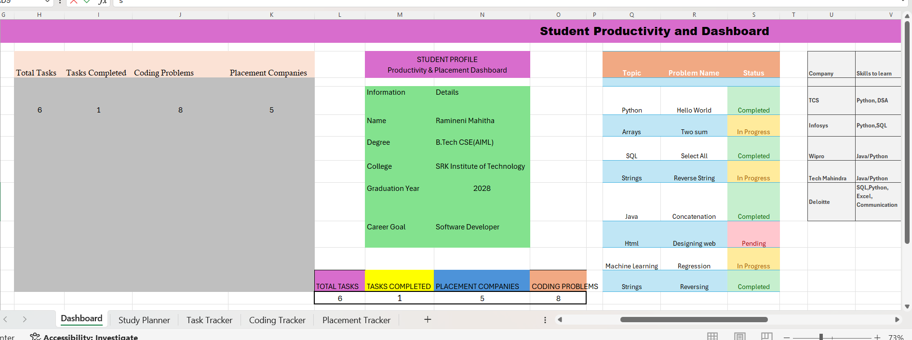
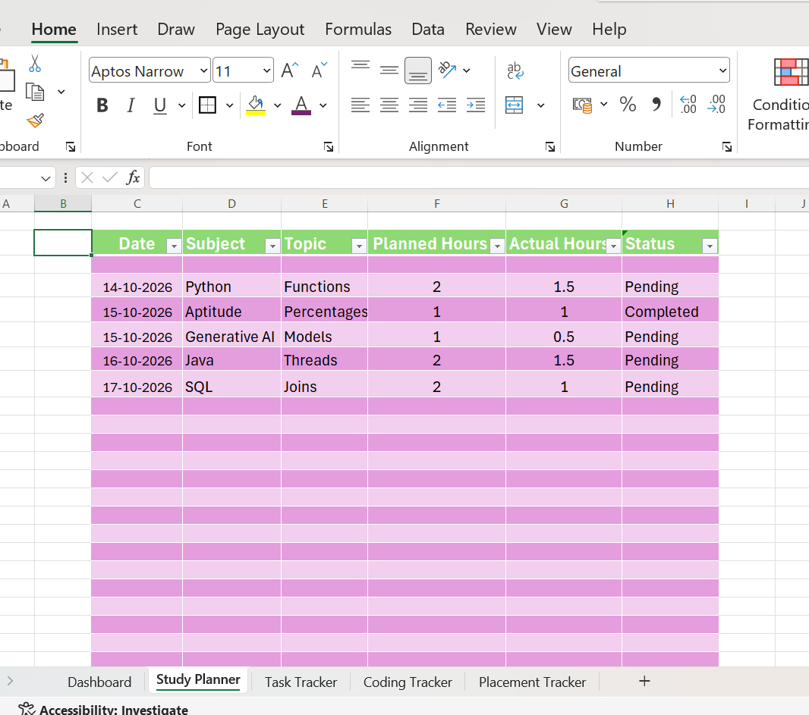
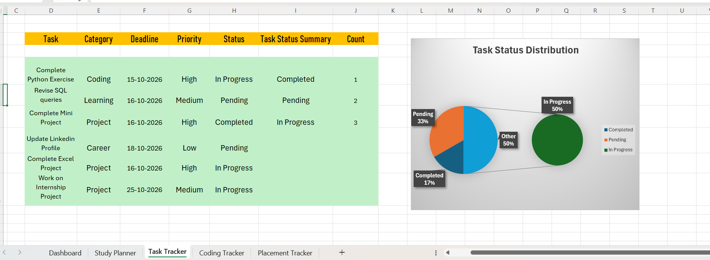
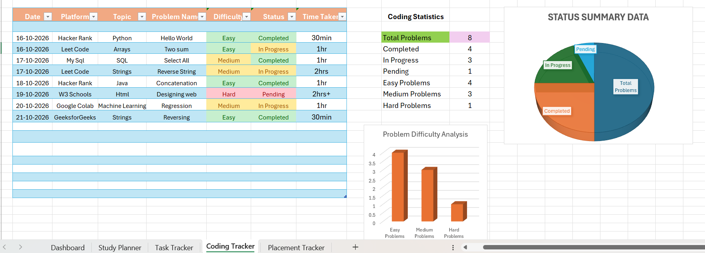
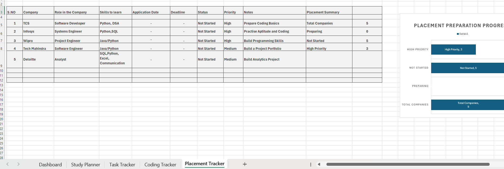

#Student Productivity Dashboard

## About the Project

The **Student Productivity Dashboard** is an Excel-based project designed to help students organize their academic activities, manage tasks, track coding practice, and monitor placement preparation in one place.

This project uses Excel tables, formulas, charts, and dashboard visuals to make student progress easier to track and understand.

## Project Objectives

- Organize daily study plans.
- Track tasks and completion status.
- Record coding practice and problem-solving progress.
- Maintain placement preparation and company details.
- Monitor productivity through a visual dashboard.

## Key Features

### Study Planner
Plan and organize study activities.

### Task Tracker
Manage tasks, priorities, and completion status.

### Coding Tracker
Record coding practice and track problem-solving activities.

### Placement Tracker
Maintain placement-related company and preparation details.

### Interactive Dashboard
View productivity summaries and charts in one place.

## Tools and Technologies

- Microsoft Excel
- Excel Formulas and Functions
- Data Validation
- Charts and Data Visualization
- Dashboard Design

## Project Screenshots

### 1. Main Dashboard

### 2. Study Planner

### 3. Task Tracker

### 4. Coding Tracker

### 5. Placement Tracker

## What I Learned

- Organizing and managing data in Excel.
- Using formulas to calculate productivity metrics.
- Creating charts and visual summaries.
- Designing a structured dashboard.
- Improving planning, tracking, and data presentation skills.

## Developed By

**Ramineni Mahitha**  
B.Tech – Computer Science and Engineering (AI & ML)  
SRK Institute of Technology

---

*Built as a learning project to improve productivity, Excel, and data visualization skills.*
